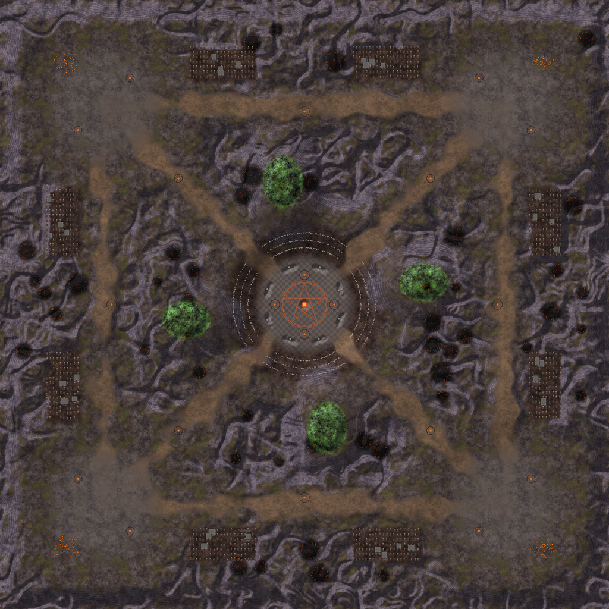

# Map: AKUMA

## Preview

## Download
[AKUMA.sd7](./AKUMA.sd7)

## Video
Please match the appropriate video from the YouTube playlist:
https://www.youtube.com/watch?v=49rQTUY--tw&list=PLERpsnKiFUjU

## Map Properties
- Description: Zombie graveyard wasteland - 4 teams x 4 players, few but generous mexes
- Size: 16 x 16 map units  (8,192 x 8,192 elmos)
- Terrain Type: Primarily Land
- Notable Features: Zombie graveyard wasteland - 4 teams x 4 players, few but generous mexes

## Mexes (Metal Extractors)
- Total Mexes: 20
- Starting Mexes per team: 1.25
- Mex Distribution: 30 m/s x12, 40 m/s x4, 50 m/s x4

## Geothermal Vents (Geos)
- Total Geos: 0

## Strategic Notes
Add any strategic insights about the map here.