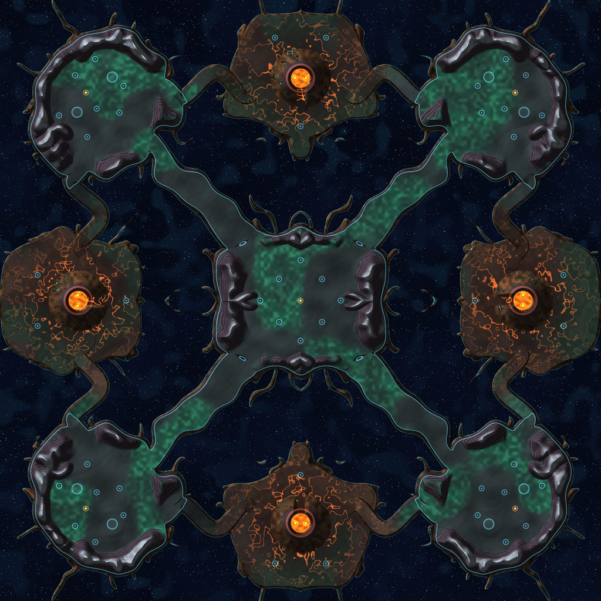

# Map: avatar_v2

## Preview

## Download
[avatar_v2.sd7](./avatar_v2.sd7)

## Video
Please match the appropriate video from the YouTube playlist:
https://www.youtube.com/watch?v=49rQTUY--tw&list=PLERpsnKiFUjU

## Map Properties
- Description: Iceberg-like volcanic mountains float in the void, held by living roots. Take and hold the central peak. Geothermal vents sleep inside the volcano craters. 4v4.
- Size: 14 x 14 map units  (7,168 x 7,168 elmos)
- Terrain Type: Oceanic
- Notable Features: Iceberg-like volcanic mountains float in the void, held by living roots. Take and hold the central peak. Geothermal vents sleep inside the volcano craters. 4v4.

## Mexes (Metal Extractors)
- Total Mexes: 48
- Starting Mexes per team: 6.00
- Mex Distribution: TBD

## Geothermal Vents (Geos)
- Total Geos: 13

## Strategic Notes
Add any strategic insights about the map here.