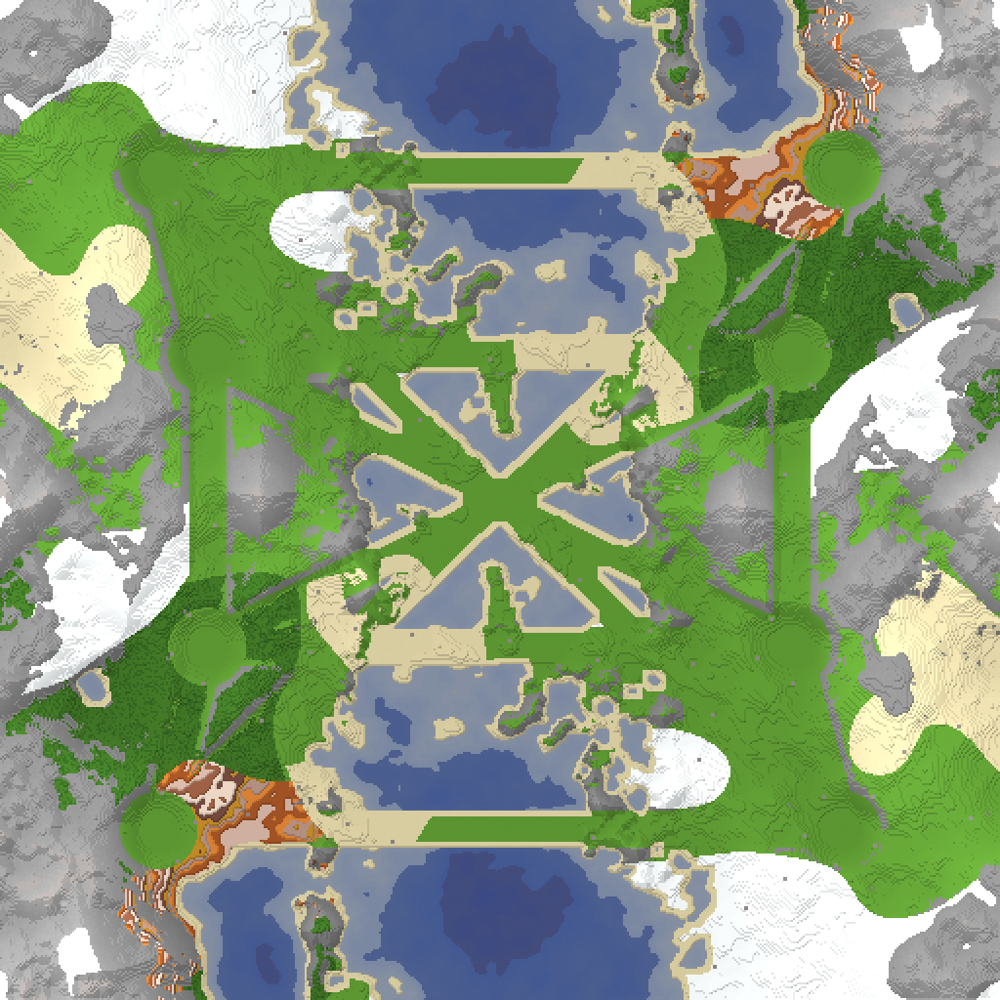

# Map: BLOCKLAND

## Preview

## Download
[minecraft_blockland_overworld_v2.sd7](./minecraft_blockland_overworld_v2.sd7)

## Video
Please match the appropriate video from the YouTube playlist:
https://www.youtube.com/watch?v=49rQTUY--tw&list=PLERpsnKiFUjU
(Note: Manual association required.)

## Map Properties
- Description: Voxel-pile hills with plains, forests, deserts, snowy peaks and oceans. Reclaimable trees, shrubs, boulders and ore. 16x16, 4v4, rotational symmetry.
- Size: 16 x 16 map units  (8,192 x 8,192 elmos)
- Terrain Type: Mixed (Land and Water)
- Notable Features: Voxel-pile hills with plains, forests, deserts, snowy peaks and oceans. Reclaimable trees, shrubs, boulders and ore. 16x16, 4v4, rotational symmetry.

## Mexes (Metal Extractors)
- Total Mexes: 94
- Starting Mexes per team: 11.75
- Mex Distribution: TBD

## Geothermal Vents (Geos)
- Total Geos: 0

## Strategic Notes
Add any strategic insights about the map here.
