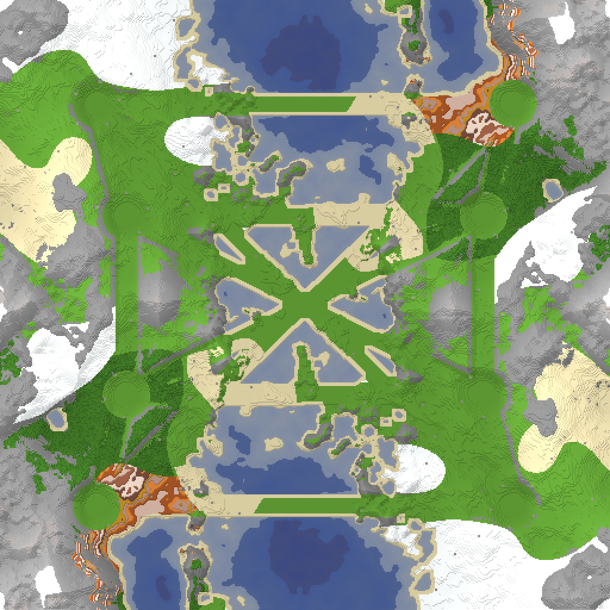

# Map: minecraft_blockland_overworld_v2

## Preview

## Download
[minecraft_blockland_overworld_v2.sd7](./minecraft_blockland_overworld_v2.sd7)

## Video
Please match the appropriate video from the YouTube playlist:
https://www.youtube.com/watch?v=49rQTUY--tw&list=PLERpsnKiFUjU
(Note: Manual association required.)

## Map Properties
*To be filled in by the user:*
- Description: 
- Size:
- Terrain Type:
- Notable Features:

## Mexes (Metal Extractors)
*Count and placement to be determined:*
- Total Mexes:
- Starting Mexes per team:
- Mex Distribution:

## Strategic Notes
*Add any strategic insights about the map here.*