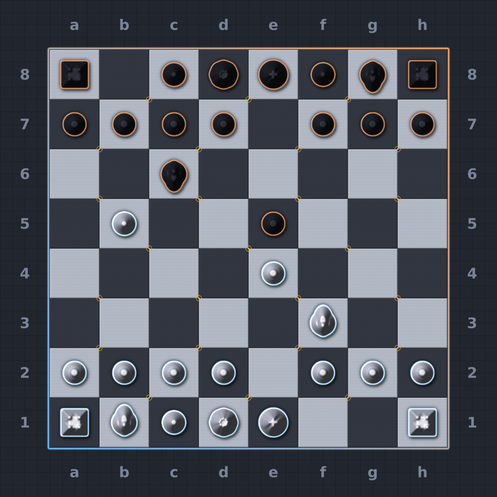

# Map: chess_classical_v1

## Preview

## Download
[chess_classical_v1.sd7](./chess_classical_v1.sd7)

## Video
Please match the appropriate video from the YouTube playlist:
https://www.youtube.com/watch?v=49rQTUY--tw&list=PLERpsnKiFUjU

## Map Properties
- Description: A classical chess game (Ruy Lopez, 3.Bb5). Pieces are impassable plateaus - walk the files, build on top with air.
- Size: 10 x 10 map units  (5,120 x 5,120 elmos)
- Terrain Type: Primarily Land
- Notable Features: A classical chess game (Ruy Lopez, 3.Bb5). Pieces are impassable plateaus - walk the files, build on top with air.

## Mexes (Metal Extractors)
- Total Mexes: 25
- Starting Mexes per team: 12.50
- Mex Distribution: TBD

## Geothermal Vents (Geos)
- Total Geos: 0

## Strategic Notes
Add any strategic insights about the map here.