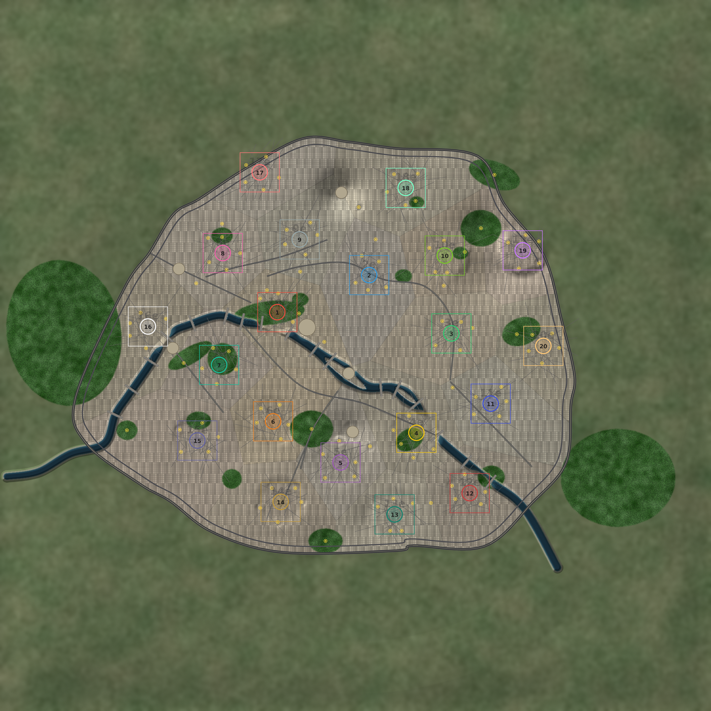

# Map: paris

## Preview

## Download
[paris.sd7](./paris.sd7)

## Video
Please match the appropriate video from the YouTube playlist:
https://www.youtube.com/watch?v=49rQTUY--tw&list=PLERpsnKiFUjU

## Map Properties
- Description: Paris, 20 player FFA: one arrondissement per player, spawn boxes at the arrondissement centres. Reclaim the mini landmarks (Eiffel Tower, Arc de Triomphe, Sacre-Coeur, Louvre, Notre-Dame, Pantheon) for up to 500 metal. The Seine is water; cross at the bridges.
- Size: 16 x 16 map units  (8,192 x 8,192 elmos)
- Terrain Type: Primarily Land
- Notable Features: Paris, 20 player FFA: one arrondissement per player, spawn boxes at the arrondissement centres. Reclaim the mini landmarks (Eiffel Tower, Arc de Triomphe, Sacre-Coeur, Louvre, Notre-Dame, Pantheon) for up to 500 metal. The Seine is water; cross at the bridges.

## Mexes (Metal Extractors)
- Total Mexes: 117
- Starting Mexes per team: 5.85
- Mex Distribution: TBD

## Geothermal Vents (Geos)
- Total Geos: 0

## Strategic Notes
Add any strategic insights about the map here.