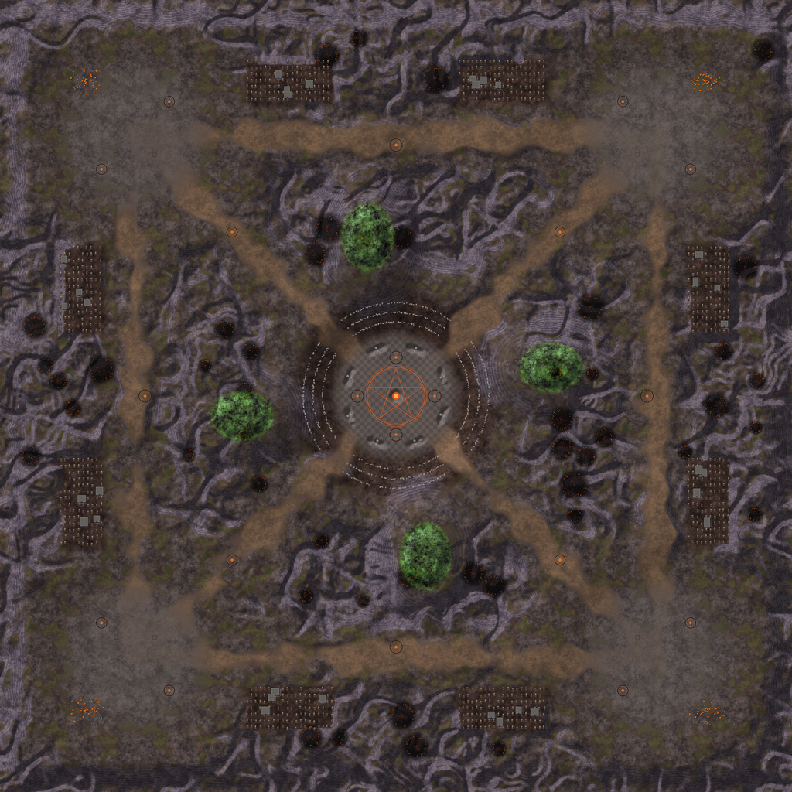
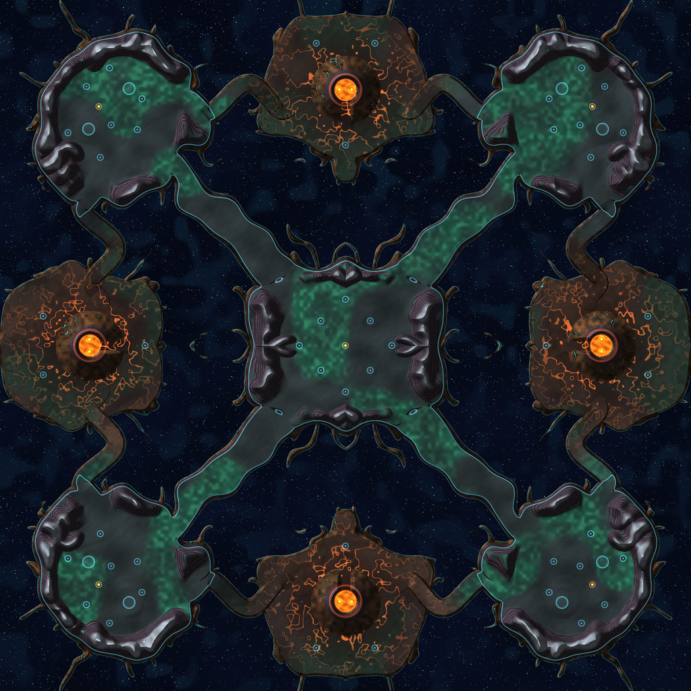
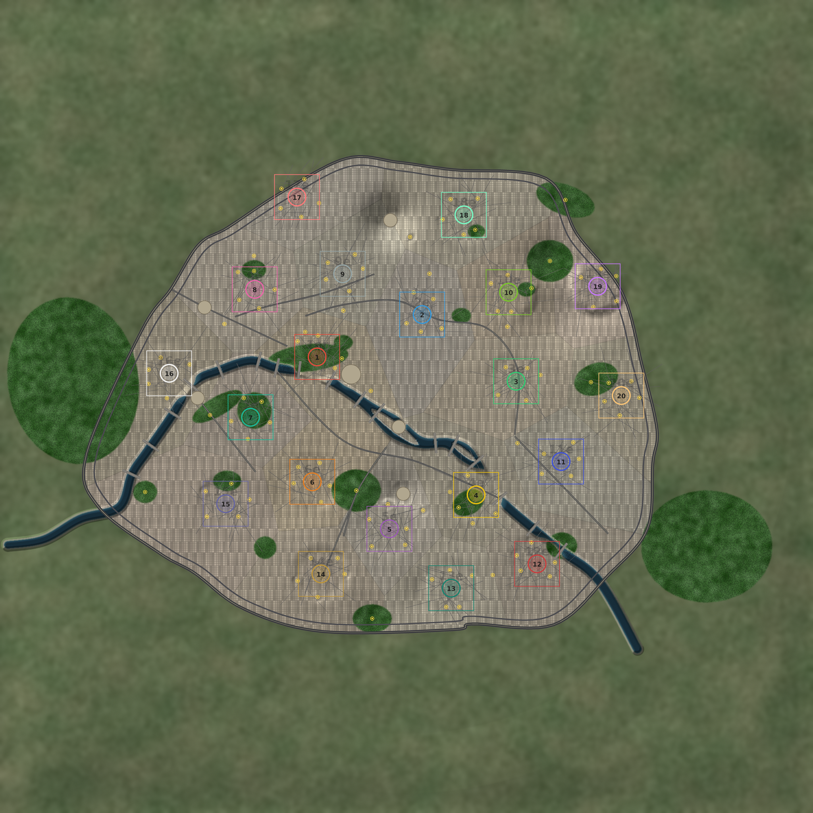
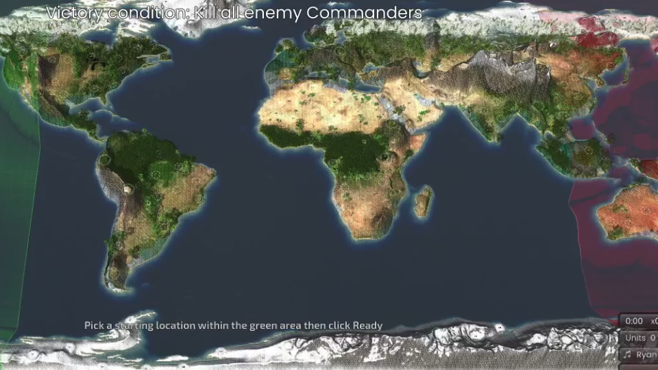
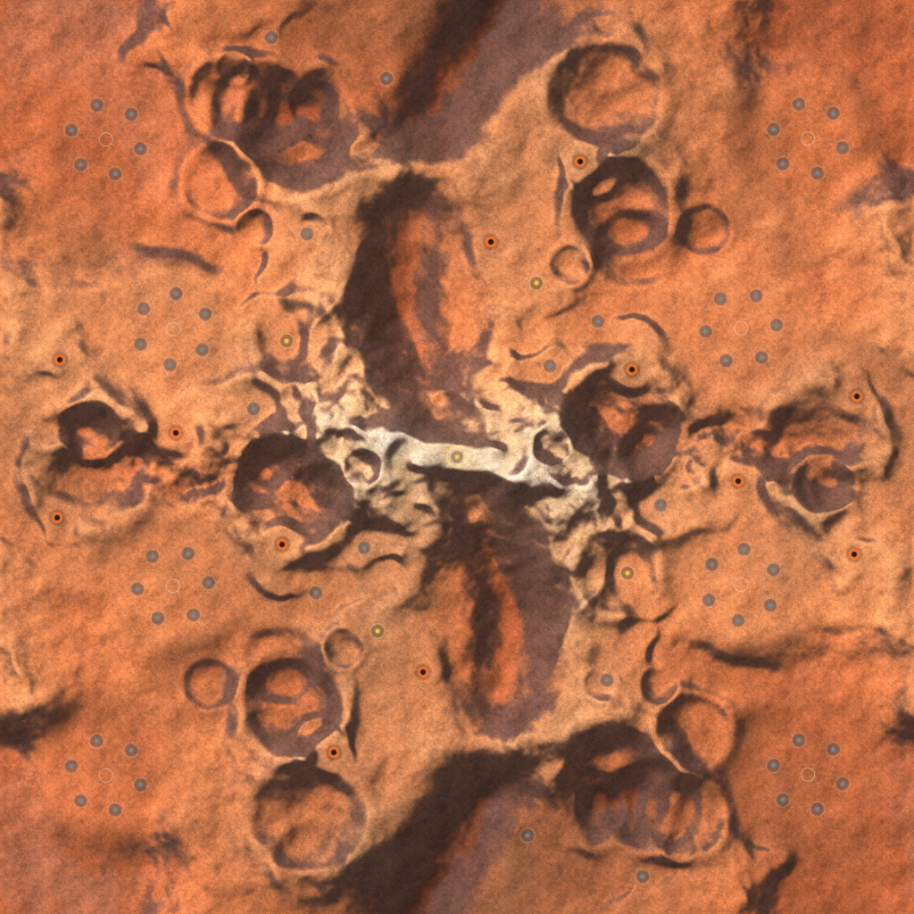
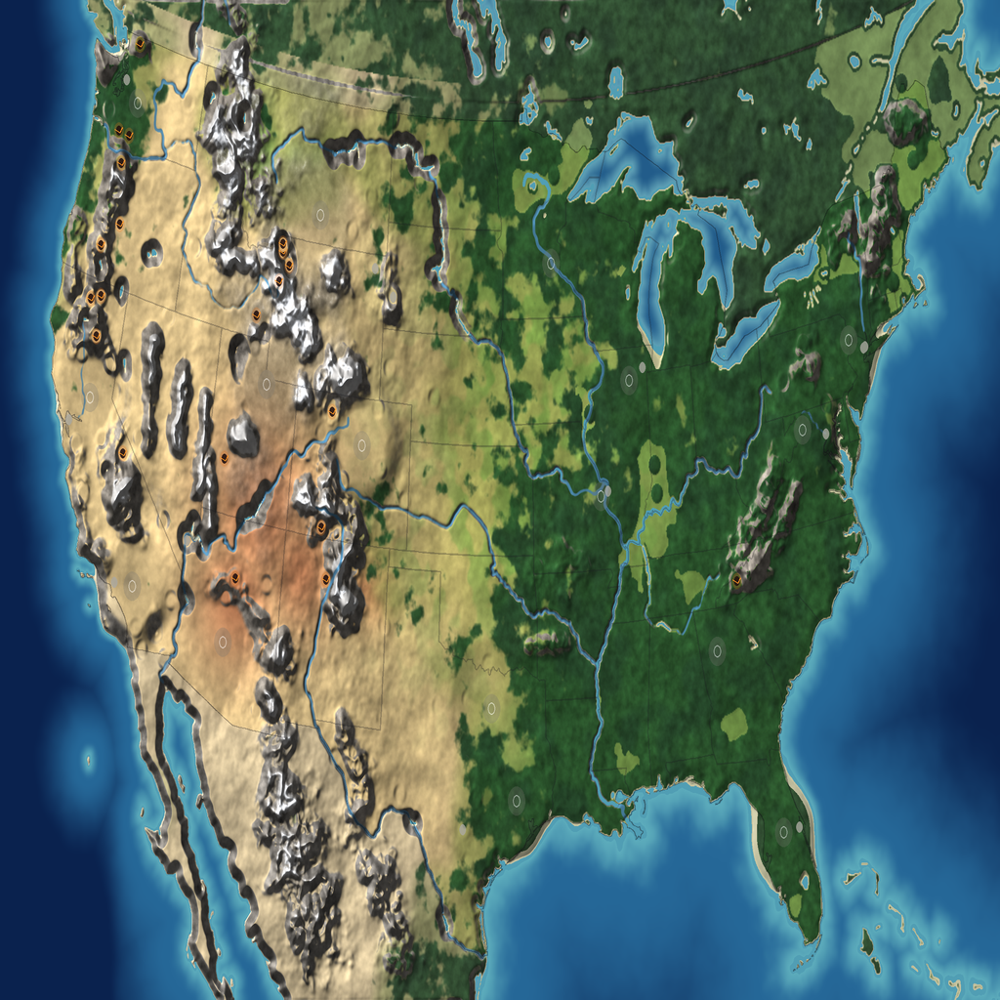
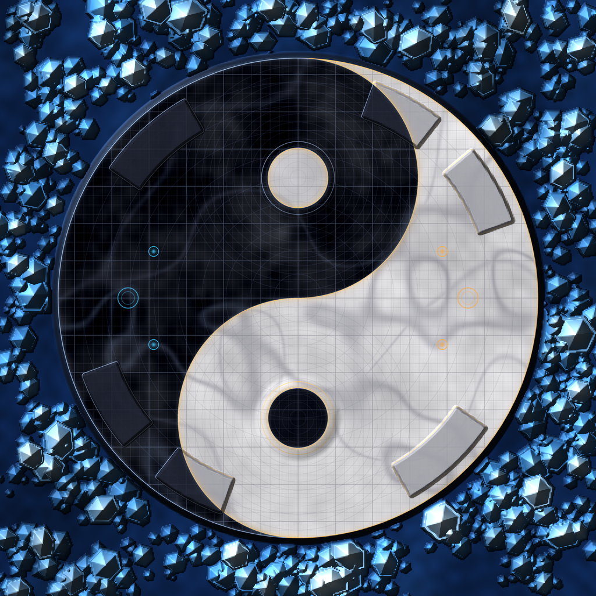
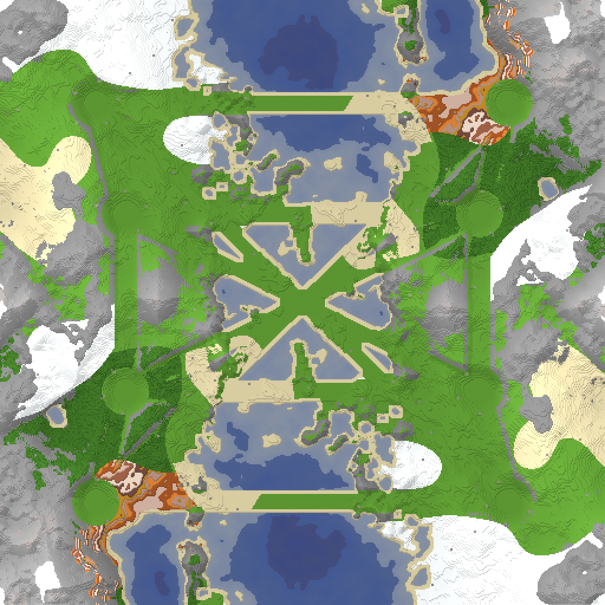
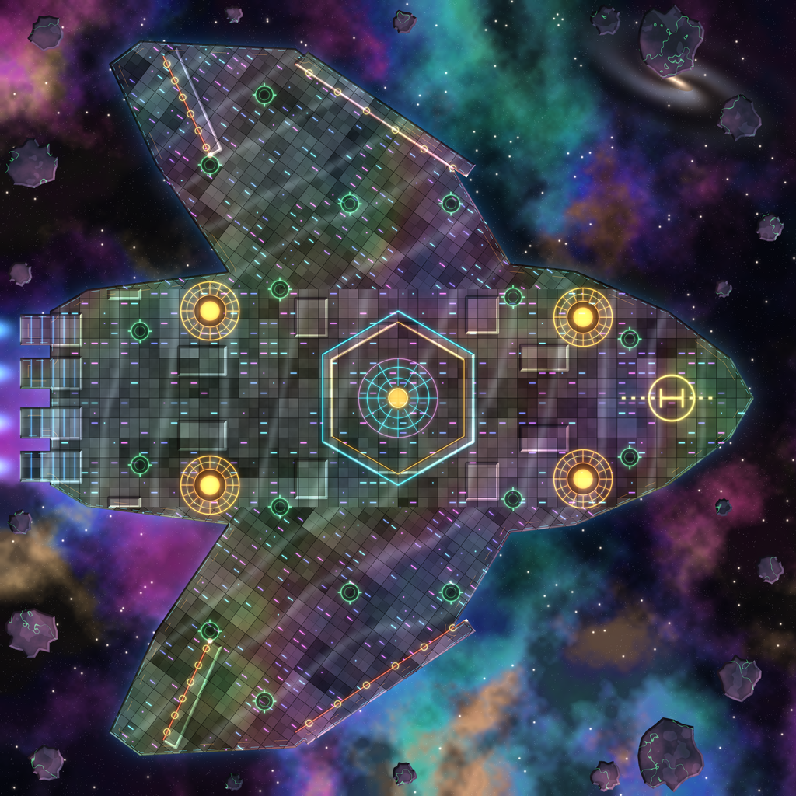
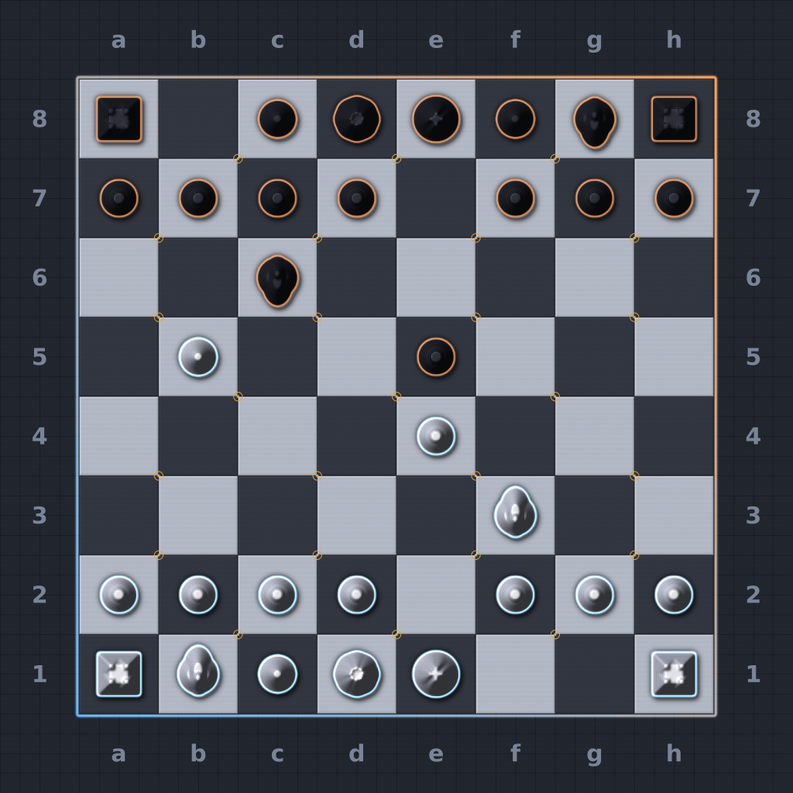

# Maps - Beyond All Reason

This directory contains map packages and documentation for Beyond All Reason. Each map has a `.md` documentation file, a `.sd7` archive, and a preview/minimap image, all located inside their corresponding subdirectory.

## Maps

| Map | Documentation | Preview | Archive | Notes |
|-----|---------------|---------|---------|-------|
| AKUMA | [AKUMA.md](./AKUMA/AKUMA.md) |  | [AKUMA.sd7](./AKUMA/AKUMA.sd7) | haunted map mostly for 4v4v4v4 zombie lobsters |
| avatar_v2 | [avatar_v2.md](./AVATAR/avatar_v2.md) |  | [avatar_v2.sd7](./AVATAR/avatar_v2.sd7) | mostly for 2v2v2v2 or 1v1v1v1 but also for teams like 4v4 |
| paris | [paris.md](./PARIS/paris.md) |  | [paris.sd7](./PARIS/paris.sd7) | mostly for FFA with up to 16 or 20 players |
| planet_earth_v1 | [planet_earth_v1.md](./planet_earth/planet_earth_v1.md) |  | [planet_earth_v1.sd7](./planet_earth/planet_earth_v1.sd7) | mostly for FFA with up to 16 or 20 players |
| planet_mars | [planet_mars.md](./planet_mars/planet_mars.md) |  | [planet_mars.sd7](./planet_mars/planet_mars.sd7) | hardest map mostly for 4v4 |
| usa | [usa.md](./USA/usa.md) |  | [usa.sd7](./USA/usa.sd7) | mostly for FFA with up to 16 or 20 players |
| yin-yang | [yin-yang.md](./yin-yang/yin-yang.md) |  | [yin-yang.sd7](./yin-yang/yin-yang.sd7) | for a blitz 1v1 quick match |
| BLOCKLAND | [minecraft_blockland_overworld_v2.md](./BLOCKLAND/minecraft_blockland_overworld_v2.md) |  | [minecraft_blockland_overworld_v2.sd7](./BLOCKLAND/minecraft_blockland_overworld_v2.sd7) |  procedural map with less than 1 MB based on Minecraft voxels |
| cosmic_spaceship_v1 | [SPACESHIP/cosmic_spaceship_v1.md](./SPACESHIP/cosmic_spaceship_v1.md) |  | [cosmic_spaceship_v1.sd7](../cosmic_spaceship_v1.sd7) | for 1v1 or 2v2 |
| chess_classical_v1 | [chess_classical_v1.md](./CHESS/chess_classical_v1.md) |  | [chess_classical_v1.sd7](./CHESS/chess_classical_v1.sd7) | 1v1 to 3v3 versatile map |

## Directories

- `AKUMA/` - AKUMA map files
- `AVATAR/` - avatar_v2 map files
- `CHESS/` - chess_classical_v1 map files
- `PARIS/` - paris map files
- `planet_earth/` - planet_earth_v1 map files
- `planet_mars/` - planet_mars map files
- `SPACESHIP/` - cosmic_spaceship_v1 map files
- `USA/` - usa map files
- `yin-yang/` - yin-yang map files
- `BLOCKLAND/` - BLOCKLAND map files

## Video Playlist

Map videos are available on YouTube. Please match the appropriate video to each map:

https://www.youtube.com/watch?v=49rQTUY--tw&list=PLERpsnKiFUjU

(Note: Manual association required.)

## Map Properties

Each map's `.md` file includes sections for:
- Preview image
- Download link
- Video reference
- Map Properties (Description, Size, Terrain Type, Notable Features)
- Mexes (Metal Extractors) count and placement
- Strategic Notes

