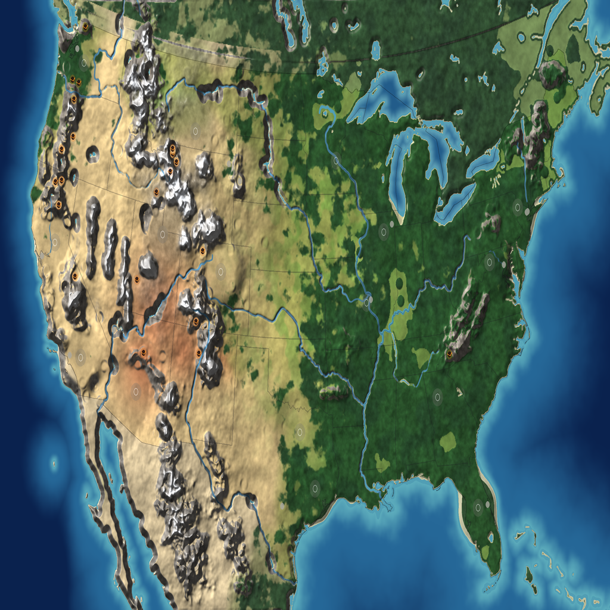

# Map: usa

## Preview

## Download
[usa.sd7](./usa.sd7)

## Video
Please match the appropriate video from the YouTube playlist:
https://www.youtube.com/watch?v=49rQTUY--tw&list=PLERpsnKiFUjU

## Map Properties
- Description: Contiguous United States: real coastlines, Great Lakes, rivers, mountain ranges and forests. 16-way FFA. 13 monuments (450 metal each) and 21 geothermal vents.
- Size: 20 x 12 map units  (10,240 x 6,144 elmos)
- Terrain Type: Mixed (Land and Water)
- Notable Features: Contiguous United States: real coastlines, Great Lakes, rivers, mountain ranges and forests. 16-way FFA. 13 monuments (450 metal each) and 21 geothermal vents.

## Mexes (Metal Extractors)
- Total Mexes: 160
- Starting Mexes per team: 10.00
- Mex Distribution: TBD

## Geothermal Vents (Geos)
- Total Geos: 21

## Strategic Notes
Add any strategic insights about the map here.