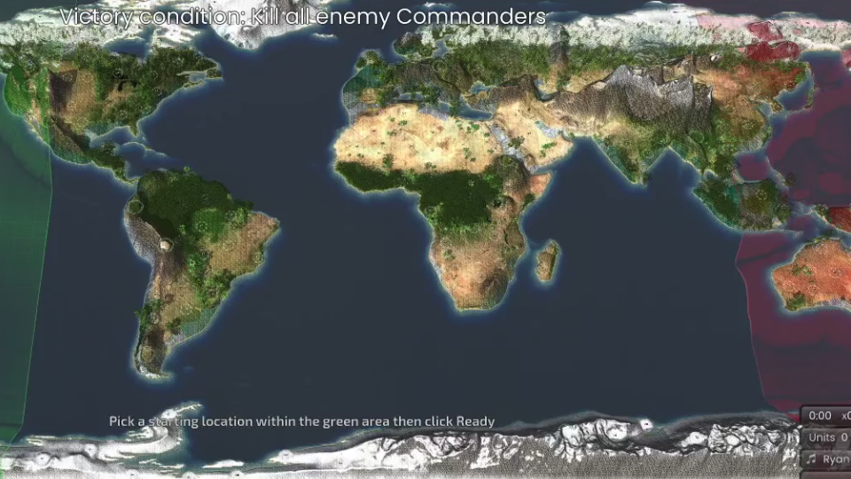

# Map: planet_earth_v1

## Preview

## Download
[planet_earth_v1.sd7](./planet_earth_v1.sd7)

## Video
Please match the appropriate video from the YouTube playlist:
https://www.youtube.com/watch?v=49rQTUY--tw&list=PLERpsnKiFUjU

## Map Properties
- Description: Procedural Earth: continents, mountain ranges, forests (reclaimable energy trees), seas, oceans and lakes. 16 FFA spawns, 3.0 M/s metal spots, geothermal vents in the mountains.
- Size: 24 x 12 map units  (12,288 x 6,144 elmos)
- Terrain Type: Oceanic
- Notable Features: Procedural Earth: continents, mountain ranges, forests (reclaimable energy trees), seas, oceans and lakes. 16 FFA spawns, 3.0 M/s metal spots, geothermal vents in the mountains.

## Mexes (Metal Extractors)
- Total Mexes: 193
- Starting Mexes per team: 12.06
- Mex Distribution: TBD

## Geothermal Vents (Geos)
- Total Geos: 26

## Strategic Notes
Add any strategic insights about the map here.