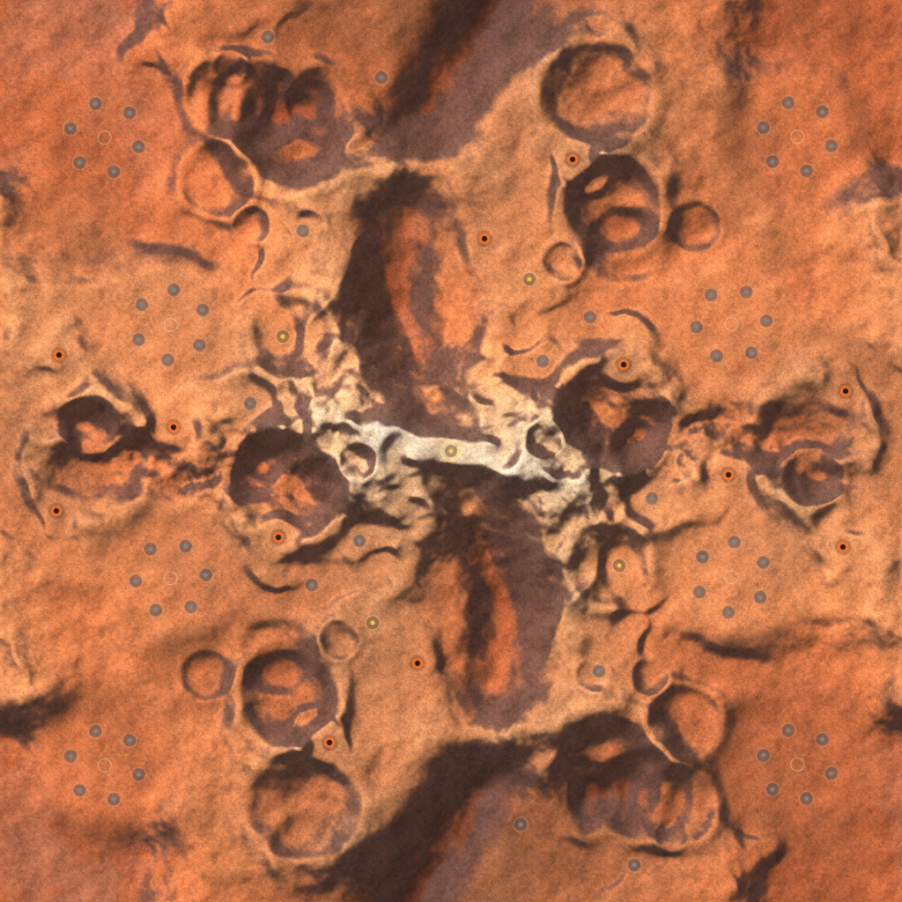

# Map: planet_mars

## Preview

## Download
[planet_mars.sd7](./planet_mars.sd7)

## Video
Please match the appropriate video from the YouTube playlist:
https://www.youtube.com/watch?v=49rQTUY--tw&list=PLERpsnKiFUjU

## Map Properties
- Description: Rust-red Martian highlands for 4v4. Ridged mountain ranges, a meandering Valles-style canyon with three crossings, rich 3.0 M/s metal around every spawn, precious-metal veins and geothermal vents hidden in the mountains.
- Size: 16 x 16 map units  (8,192 x 8,192 elmos)
- Terrain Type: Primarily Land
- Notable Features: Rust-red Martian highlands for 4v4. Ridged mountain ranges, a meandering Valles-style canyon with three crossings, rich 3.0 M/s metal around every spawn, precious-metal veins and geothermal vents hidden in the mountains.

## Mexes (Metal Extractors)
- Total Mexes: 77
- Starting Mexes per team: 9.62
- Mex Distribution: 2 m/s x12, 3 m/s x60, 5 m/s x4, 8 m/s x1

## Geothermal Vents (Geos)
- Total Geos: 12

## Strategic Notes
Add any strategic insights about the map here.